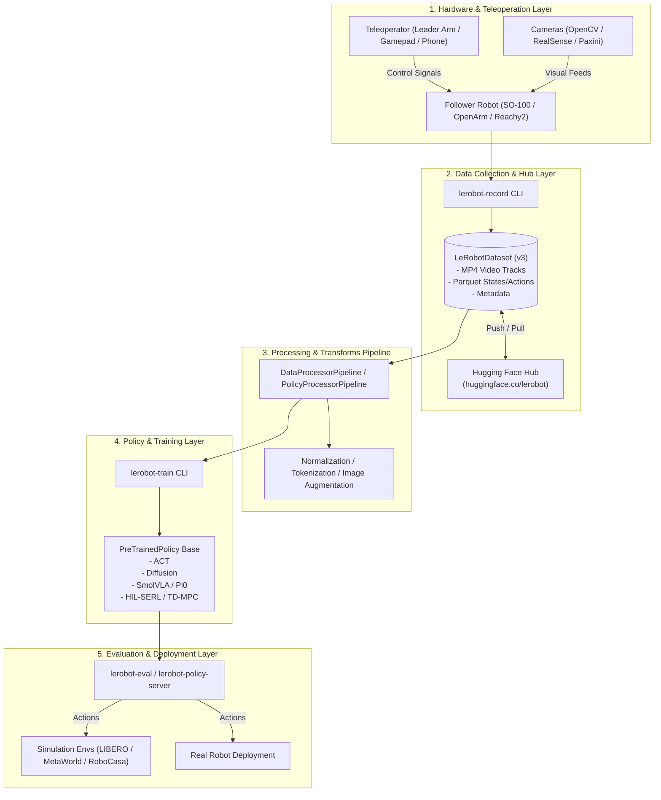
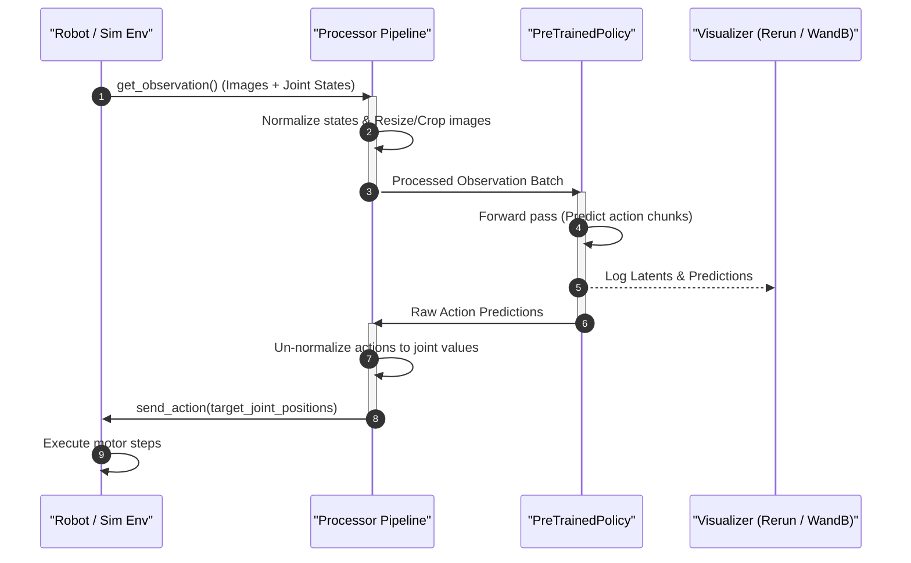
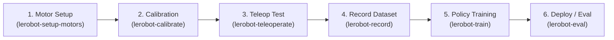

# LeRobot Codebase Analysis & Architecture Guide

> [!NOTE]
> ဤ Document သည် **Hugging Face LeRobot** repository ၏ Architecture, Core Modules, Data Flow နှင့် End-to-End Workflows များကို စနစ်တကျ Analysis လုပ်ထားသော Technical Guide ဖြစ်ပါသည်။

---

## 1. Executive Summary

[LeRobot](file:///home/hmue_gyi/Desktop/Git/lerobot/README.md) သည် Real-World Robotics အတွက် **PyTorch** ဖြင့် ဖန်တီးထားသော Open-Source Framework ဖြစ်ပါသည်။ Robotics တွင် ကြုံတွေ့ရလေ့ရှိသော Hardware မတူညီမှုများ၊ Dataset format မတူညီမှုများနှင့် AI Policy များကို Real Robot ပေါ် Deploy လုပ်ရခက်ခဲမှုများကို ဖြေရှင်းပေးရန် ရည်ရွယ်သည်။

### Key Goals (၄) ခု:
1. **Hardware-Agnostic Interface**: Low-cost 3D-printed arms (ဥပမာ SO-100/SO-101) မှသည် Industrial Arms နှင့် Humanoid Robots များအထိ standard Python interface တစ်ခုတည်းဖြင့် ထိန်းချုပ်နိုင်ခြင်း။
2. **Unified Dataset Standard ([`LeRobotDataset`](file:///home/hmue_gyi/Desktop/Git/lerobot/src/lerobot/datasets/lerobot_dataset.py))**: Camera Video streams (MP4) နှင့် Motor/Sensor states (Parquet format) များကို Hugging Face Hub ပေါ်တွင် efficient စွာ store လုပ်ခြင်း၊ stream လုပ်ခြင်းနှင့် visualize ပြုလုပ်နိုင်ခြင်း။
3. **State-of-the-Art Policies**: Imitation Learning (ACT, Diffusion), Reinforcement Learning (HIL-SERL, TD-MPC) နှင့် Multimodal Vision-Language-Action (VLA - $\pi_0$, SmolVLA, GR00T) model များကို ready-to-train/deploy ပေးထားခြင်း။
4. **Seamless Sim-to-Real**: Simulation benchmarks (LIBERO, MetaWorld) နှင့် Real Hardware အကြား တူညီသော observation/action contract ဖြင့် အလွယ်တကူ switch လုပ်နိုင်ခြင်း။

---

## 2. System Architecture

LeRobot ၏ overall system architecture နှင့် module များ ချိတ်ဆက်ပုံ:



---

## 3. Core Modules & Directory Structure

Source code အားလုံးသည် [`src/lerobot/`](file:///home/hmue_gyi/Desktop/Git/lerobot/src/lerobot/) အောက်တွင် modular ဖြစ်စွာ တည်ဆောက်ထားသည်။

```
src/lerobot/
├── robots/              # Hardware Abstraction Layer (Robot implementations)
├── teleoperators/       # Teleoperation input devices (Leader arms, Gamepads, Phone)
├── motors/              # Low-level motor drivers (Feetech, Dynamixel, Damiao)
├── cameras/             # Camera drivers (OpenCV, RealSense, etc.)
├── datasets/            # LeRobotDataset class & Hub interactions
├── processor/           # Input/Output data pipelines & Normalization
├── policies/            # AI Policies (ACT, Diffusion, SmolVLA, Pi0, etc.)
├── envs/                # Gym simulation environment integrations
├── scripts/             # Main entry-point CLI utilities
└── configs/             # Draccus configuration dataclasses
```

### 3.1 Hardware Layer ([`src/lerobot/robots/`](file:///home/hmue_gyi/Desktop/Git/lerobot/src/lerobot/robots/))
- **Base Class**: [`Robot`](file:///home/hmue_gyi/Desktop/Git/lerobot/src/lerobot/robots/robot.py) base class ဖြစ်ပြီး robot hardware တိုင်းအတွက် clean interface ပေးထားသည်။
- **Key Methods**: `connect()`, `get_observation()`, `send_action()`, `disconnect()`
- **Supported Robots**:
  - `so_follower`, `bi_so_follower` (SO-100 / SO-101 single & bimanual)
  - `openarm_follower`, `bi_openarm_follower`
  - `reachy2`, `unitree_g1`, `hope_jr`, `koch_follower`, `lekiwi`, `earthrover_mini_plus`
- **Plugin System**: 3rd-party robots များကို `lerobot_robot_<name>` package name ဖြင့် install လုပ်ရုံဖြင့် auto-discovery ပြုလုပ်နိုင်သည်။

### 3.2 Dataset Layer ([`src/lerobot/datasets/`](file:///home/hmue_gyi/Desktop/Git/lerobot/src/lerobot/datasets/))
- **Core Class**: [`LeRobotDataset`](file:///home/hmue_gyi/Desktop/Git/lerobot/src/lerobot/datasets/lerobot_dataset.py)
- **Format Architecture**: Episode-aware structure
  - **Vision**: Camera frames များကို Synchronized MP4 video tracks အဖြစ် သိမ်းဆည်းသည်။ PyAV သို့မဟုတ် TorchCodec ဖြင့် fast frame decoding လုပ်ဆောင်သည်။
  - **States & Actions**: Joint positions, velocities, gripper states များကို Apache Parquet format ဖြင့် compress လုပ်သိမ်းဆည်းသည်။
  - **HF Hub Integration**: Hub ပေါ်သို့ တိုက်ရိုက် push/pull ပြုလုပ်နိုင်ပြီး browser မှ dataset viewer ဖြင့် တိုက်ရိုက် inspect လုပ်နိုင်သည်။

### 3.3 Policy Layer ([`src/lerobot/policies/`](file:///home/hmue_gyi/Desktop/Git/lerobot/src/lerobot/policies/))
- **Base Class**: [`PreTrainedPolicy`](file:///home/hmue_gyi/Desktop/Git/lerobot/src/lerobot/policies/pretrained.py) (`torch.nn.Module` + Hugging Face `HubMixin`)
- **Key Policy Categories**:
  - **Imitation Learning**:
    - **ACT**: Action Chunking with Transformers (လူသုံးအများဆုံး manipulation policy)
    - **Diffusion Policy**: Multi-modal action distributions များကို စွမ်းဆောင်ရည်မြင့်မားစွာ ဖမ်းယူနိုင်သော model
    - **VQ-BeT**, **Multi-task DiT Policy**
  - **VLA (Vision-Language-Action)**:
    - **SmolVLA**, **$\pi_0$ (Pi0)**, **$\pi_{0.5}$**, **GR00T**, **MolmoAct2**, **X-VLA**
    - Natural language prompt များကို လက်ခံပြီး robot action များ တိုက်ရိုက် generate လုပ်ပေးသည်။
  - **Reinforcement Learning**:
    - **HIL-SERL** (Human-in-the-loop Sample-Efficient RL)
    - **TD-MPC**

### 3.4 Processor Pipeline ([`src/lerobot/processor/`](file:///home/hmue_gyi/Desktop/Git/lerobot/src/lerobot/processor/))
- **Core Class**: [`PolicyProcessorPipeline`](file:///home/hmue_gyi/Desktop/Git/lerobot/src/lerobot/processor/pipeline.py)
- Observation/Action များကို Policy သို့ မပို့မီ normalizer (Min-Max / Mean-Std), Tokenizer, Image Augmentation step များကို modular pipeline အနေဖြင့် run ပေးသည်။

### 3.5 Simulation Environments ([`src/lerobot/envs/`](file:///home/hmue_gyi/Desktop/Git/lerobot/src/lerobot/envs/))
- Gymnasium framework အပေါ် အခြေခံထားပြီး Standard Benchmarks များကို support လုပ်သည်:
  - **LIBERO**: Benchmark for robot manipulation
  - **MetaWorld**: Multi-task robot manipulation
  - **RoboCasa / RoboMME**: Kitchen and household manipulation

---

## 4. Runtime Data Flow

Observation မှ Action ထွက်ရှိပြီး Robot ထံသို့ Action execution ပြုလုပ်သည့် Data Flow:



---

## 5. CLI Commands Reference

LeRobot တွင် built-in ပါဝင်သော အဓိက CLI scripts များ:

| Category | Command | Description |
| :--- | :--- | :--- |
| **Hardware Discovery** | `lerobot-find-port` | ချိတ်ဆက်ထားသော USB Serial ports (ဥပမာ `/dev/ttyACM0`) များကို auto-detect လုပ်ပေးသည်။ |
| **Camera Inspection** | `lerobot-find-cameras` | တပ်ဆင်ထားသော USB/UVC cameras များ၏ index နှင့် resolution များကို scan လုပ်သည်။ |
| **Motor Setup** | `lerobot-setup-motors` | Feetech/Dynamixel motors များအတွက် ID နှင့် Baudrate configure လုပ်ပေးသည်။ |
| **Calibration** | `lerobot-calibrate` | Robot arms များ၏ joint limits နှင့် zero positions များကို calibrate လုပ်သည်။ |
| **Teleoperation** | `lerobot-teleoperate` | Leader arm / Gamepad ဖြင့် Follower robot ကို direct control စမ်းသပ်သည်။ |
| **Data Recording** | `lerobot-record` | Teleoperation လုပ်ဆောင်ချက်များကို LeRobotDataset format ဖြင့် record လုပ်သည်။ |
| **Data Replay** | `lerobot-replay` | Record ပြီးသား episode များကို robot ပေါ်တွင် ပြန်လည် replay လုပ်ပြသည်။ |
| **Visualization** | `lerobot-dataset-viz` | Rerun visualizer ဖြင့် dataset video များနှင့် trajectory charts များကို inspect လုပ်သည်။ |
| **Training** | `lerobot-train` | ရွေးချယ်ထားသော policy ကို dataset ဖြင့် train သည်။ |
| **Evaluation** | `lerobot-eval` | Model checkpoint ကို simulation သို့မဟုတ် real robot ပေါ်တွင် evaluate လုပ်သည်။ |

---

## 6. End-to-End Workflow (SO-101 Example)

SO-101 arm ကဲ့သို့သော real hardware ဖြင့် စတင်အသုံးပြုသည့် Standard Workflow:



### Step 1: Motor Setup & Calibration
```bash
# Setup motors
lerobot-setup-motors --robot.type=so101_follower --robot.port=/dev/ttyACM0
lerobot-setup-motors --teleop.type=so101_leader  --teleop.port=/dev/ttyACM1

# Calibrate joint limits
lerobot-calibrate --robot.type=so101_follower --robot.port=/dev/ttyACM0 --robot.id=my_follower
lerobot-calibrate --teleop.type=so101_leader  --teleop.port=/dev/ttyACM1 --teleop.id=my_leader
```

### Step 2: Dataset Recording
```bash
lerobot-record \
  --robot.type=so101_follower \
  --robot.port=/dev/ttyACM0 \
  --teleop.type=so101_leader \
  --teleop.port=/dev/ttyACM1 \
  --dataset.repo_id=${HF_USER}/so101_pick_place \
  --dataset.num_episodes=50
```

### Step 3: Policy Training (ACT)
```bash
lerobot-train \
  --policy.type=act \
  --dataset.repo_id=${HF_USER}/so101_pick_place \
  --output_dir=outputs/train/act_so101 \
  --training.batch_size=8 \
  --training.steps=50000
```

---

## 7. Development & Contribution Guidelines

Code ပြင်ဆင်ခြင်းနှင့် development လုပ်ဆောင်ရာတွင် လိုက်နာရမည့် standard များ ([`AGENTS.md`](file:///home/hmue_gyi/Desktop/Git/lerobot/AGENTS.md)):

1. **Package Management**:
   - `uv` ကိုသာ အသုံးပြုရန်:
     ```bash
     uv sync --locked --extra dev --extra test
     ```
2. **Running Python Code**:
   - `uv run` ဖြင့်သာ run ရန်:
     ```bash
     uv run pytest tests -svv --maxfail=5
     ```
3. **Linting & Formatting**:
   - Code commit မပြုလုပ်မီ pre-commit စစ်ဆေးရန်:
     ```bash
     pre-commit run --all-files
     ```
4. **Current Git Branch**:
   - လက်ရှိ active branch: `hmue_gyi`
   - မည်သည့် feature/bugfix မဆို clean ဖြစ်သော commit history ဖြင့် ထိန်းသိမ်းရန် အကြံပြုပါသည်။

---

> [!TIP]
> လက်တွေ့ တဆင့်ချင်း စတင်လုပ်ဆောင်ရန် Action Roadmap၊ Simulation အသေးစိတ်နှင့် Hardware Requirements များကို [todo.md](file:///home/hmue_gyi/Desktop/Git/lerobot/todo.md) တွင် ဆက်လက် ကြည့်ရှုနိုင်ပါသည်။
