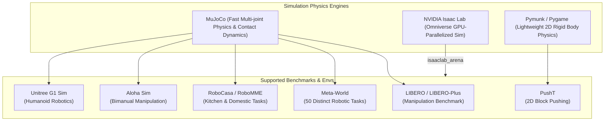

# LeRobot Implementation Roadmap & Setup Guide (TODO.md)

> [!NOTE]
> ဤ Document သည် **LeRobot** ကို အစမှအဆုံး တဆင့်ချင်း လေ့လာ၊ စမ်းသပ်၊ တည်ဆောက်နိုင်ရန် Actionable Roadmap ဖြစ်ပါသည်။ Simulation Architecture နှင့် Hardware Requirements များကိုပါ ပြည့်စုံစွာ ထည့်သွင်းဖော်ပြထားပါသည်။

---

## 1. Hardware Requirements Analysis

မော်ဒယ်များ Train ခြင်း၊ Simulation Run ခြင်းနှင့် Real Robot ထိန်းချုပ်ခြင်းတို့အတွက် လိုအပ်သော System Specs များ ဖြစ်ပါသည်:

### 1.1 Requirements Matrix

| Component | Minimum (Basic Testing / Colab) | Recommended (Local ACT / Sim) | High-End (Diffusion / VLAs) |
| :--- | :--- | :--- | :--- |
| **GPU / VRAM** | No GPU (CPU only) / Cloud Colab | **8 GB – 12 GB VRAM** (RTX 3060 / 4060) | **16 GB – 24 GB+ VRAM** (RTX 4080 / 4090 / A100) |
| **System RAM** | 8 GB – 16 GB | 16 GB – 32 GB | 32 GB – 64 GB (Video Decoding & Caching) |
| **CPU** | 6-Core (Intel i5 / AMD Ryzen 5) | 8-Core (Intel i7 / AMD Ryzen 7) | 12+ Core (High-throughput data decoding) |
| **Storage** | 30 GB SSD | 100 GB NVMe SSD | 500 GB+ NVMe SSD (Large multi-task datasets) |
| **OS** | Linux (Ubuntu 22.04 / 24.04) / macOS | Linux (Ubuntu 22.04 / 24.04 LTS) | Linux (Ubuntu 22.04 / 24.04 LTS) |

### 1.2 Policy-Specific GPU Memory Footprint

| Policy Type | Target Task | Minimum VRAM | Peak Memory (profiled) | Recommended Training Setup |
| :--- | :--- | :--- | :--- | :--- |
| **ACT** | Single-task manipulation | **~4 GB – 6 GB** | ~1 GB (SGD) / ~3 GB (AdamW) | Local Laptop / RTX 3060 / Colab Free T4 |
| **Diffusion** | Multi-modal manipulation | **8 GB – 12 GB** | ~5 GB (SGD) / ~8 GB (AdamW) | Local RTX 3080/4070 သို့မဟုတ် Cloud GPU |
| **SmolVLA** | Language-conditioned VLA | **12 GB – 16 GB** | ~4 GB (frozen) / ~12 GB (unfrozen) | RTX 4080 / RTX 3090 / Colab A100 |
| **$\pi_0$ / $\pi_{0.5}$ / X-VLA** | Large Foundation VLA | **24 GB – 80 GB** | 16 GB – 24 GB+ (batch size 1) | Cloud A100 / H100 (Google Colab Pro / RunPod) |

> [!IMPORTANT]
> **သင်၏ လက်ရှိ Local Machine Hardware အခြေအနေ:**
> - **CPU**: AMD Ryzen 5 5625U (6 Cores / 12 Threads)
> - **RAM**: ~8 GB (Free ~2 GB)
> - **GPU**: Integrated Radeon Graphics (Dedicated NVIDIA CUDA GPU မရှိပါ)
>
> **အကြံပြုချက် (Recommendation):**
> 1. Local Machine တွင် Codebase စူးစမ်းခြင်း၊ Dataset Viewer (`lerobot-dataset-viz`) ကြည့်ခြင်း၊ Simulation (`pusht` / lightweight MuJoCo) စမ်းသပ်ခြင်းနှင့် Real Hardware (SO-100/101 arm) ထိန်းချုပ်/Record လုပ်ခြင်းများကို ချောမွေ့စွာ ပြုလုပ်နိုင်ပါသည်။
> 2. မော်ဒယ် Train ရာတွင် Local CPU ဖြင့် Train လျှင် အလွန်နှေးကွေးနိုင်သောကြောင့် Hugging Face မှ တရားဝင် ထုတ်ပေးထားသော [Google Colab Notebooks](https://github.com/huggingface/notebooks/blob/main/lerobot/training-act.ipynb) (A100/T4) ကို အသုံးပြုရန် အထူးအကြံပြုပါသည်။

---

## 2. Simulation Environments & Engines

LeRobot တွင် Physical Robot မရှိသေးမီ မော်ဒယ်များကို Train/Evaluate ပြုလုပ်ရန် Simulation စနစ်များကို Gymnasium API အောက်တွင် Standardize လုပ်ထားသည်။



### ၂.၁ Simulation Engines
1. **MuJoCo (Multi-Joint dynamics with Contact)**:
   - LeRobot တွင် အဓိက အသုံးပြုထားသော Physics Engine ဖြစ်သည်။
   - CPU rendering သို့မဟုတ် GPU-accelerated EGL rendering ဖြင့် အလုပ်လုပ်သည်။ တိကျသော contact physics နှင့် fast simulation speed ကြောင့် Robotics research တွင် စံအဖြစ် သုံးသည်။
2. **NVIDIA Isaac Lab (`isaaclab_arena`)**:
   - NVIDIA Omniverse အပေါ်တွင် တည်ဆောက်ထားသော GPU-accelerated robotics simulation platform ဖြစ်သည်။
   - Environments ထောင်ပေါင်းများစွာကို GPU တစ်ခုတည်းပေါ်တွင် parallel run နိုင်ပြီး Reinforcement Learning နှင့် large-scale data collection အတွက် သင့်လျော်သည်။
3. **Pymunk / Pygame (`pusht`)**:
   - 2D Physics engine ဖြစ်ပြီး GPU မလိုအပ်ပါ။ Low-spec စက်များတွင် Diffusion Policy နှင့် ACT algorithm များကို အချိန်တိုအတွင်း စမ်းသပ်နိုင်ရန် သုံးသည်။

### ၂.၂ Built-in Benchmarks & Environments
- **`libero` / `libero_plus`**: 7-DoF Franka arm ဖြင့် object manipulation (ဥပမာ `libero_object`, `libero_spatial`) tasks များကို standard eval ပြုလုပ်ရန် သုံးသည်။
- **`metaworld`**: Sawyer robot arm ဖြင့် ခလုတ်နှိပ်ခြင်း၊ အံဆွဲဖွင့်ခြင်း၊ ပစ္စည်းရွှေ့ခြင်း အစရှိသော tasks ပေါင်း 50 ကို Multi-task learning စမ်းသပ်ရန် သုံးသည်။
- **`pusht`**: T-shaped block ကို ပစ်မှတ်နေရာသို့ တွန်းပို့ရသော benchmark ဖြစ်ပြီး CPU ပေါ်တွင် ချက်ချင်း run နိုင်သည်။
- **`robocasa`**: အိမ်တွင်း မီးဖိုချောင်သုံး စက်ရုပ် simulation ဖြစ်ပြီး complex multi-stage tasks များ ပါဝင်သည်။
- **`aloha`**: လက်နှစ်ဖက်သုံး (Bimanual) mobile manipulation tasks များအတွက် MuJoCo simulation ဖြစ်သည်။
- **`unitree_g1_mujoco`**: Unitree G1 humanoid စက်ရုပ်၏ balance နှင့် locomotion/manipulation tasks များအတွက် simulation ဖြစ်သည်။

---

## 3. Step-by-Step Action Roadmap (TODO Checklist)

အောက်ပါ Roadmap အတိုင်း အဆင့်ဆင့် စတင်လုပ်ဆောင်နိုင်ပါသည်:

### Phase 1: Environment Setup & Verification
- [ ] **1.1 Virtual Environment တည်ဆောက်ခြင်း**
  ```bash
  # Base dependencies install လုပ်ခြင်း
  uv sync --locked
  
  # Dev & Test tools များပါ တစ်ခါတည်း install လုပ်ခြင်း
  uv sync --locked --extra dev --extra test
  ```
- [ ] **1.2 Git LFS Pull ပြုလုပ်ခြင်း** (Test artifacts များနှင့် sample weights များ ဒေါင်းလုဒ်ဆွဲရန်)
  ```bash
  git lfs install && git lfs pull
  ```
- [ ] **1.3 Hugging Face Hub Login ပြုလုပ်ခြင်း** (Dataset နှင့် Model weights များ download/push လုပ်နိုင်ရန်)
  ```bash
  uv run huggingface-cli login
  ```
- [ ] **1.4 Installation အောင်မြင်မှု စစ်ဆေးခြင်း**
  ```bash
  uv run lerobot-info
  ```

---

### Phase 2: Simulation & Algorithm Testing (No Hardware Needed)
- [ ] **2.1 PushT 2D Simulation စမ်းသပ်ခြင်း** (Local CPU ပေါ်တွင် အလွယ်တကူ run နိုင်သည်)
  ```bash
  # PushT extra dependencies သွင်းခြင်း
  uv sync --locked --extra pusht
  ```
- [ ] **2.2 Pretrained Model ဖြင့် PushT Simulation တွင် Evaluation Run ခြင်း**
  ```bash
  uv run lerobot-eval \
    --policy.path=lerobot/diffusion_pusht \
    --env.type=pusht \
    --eval.n_episodes=5 \
    --eval.batch_size=1
  ```
- [ ] **2.3 MetaWorld သို့မဟုတ် LIBERO Benchmark စမ်းသပ်ခြင်း**
  ```bash
  # MetaWorld extra သွင်းခြင်း
  uv sync --locked --extra metaworld
  
  # ACT Policy ဖြင့် MetaWorld တွင် evaluation run ခြင်း
  uv run lerobot-eval \
    --policy.path=lerobot/act_aloha_sim_transfer_cube_human \
    --env.type=aloha \
    --env.task=AlohaTransferCube-v0 \
    --eval.n_episodes=2
  ```

---

### Phase 3: Dataset Inspection & Visualization
- [ ] **3.1 Hugging Face Hub ပေါ်ရှိ Official Dataset တစ်ခုကို Visualization ကြည့်ရှုခြင်း**
  ```bash
  # Rerun visualization tool ပါဝင်သော viz extra သွင်းခြင်း
  uv sync --locked --extra dataset_viz
  
  # Aloha dataset ကို video visualizer ဖြင့် ဖွင့်ကြည့်ခြင်း
  uv run lerobot-dataset-viz \
    --repo-id=lerobot/aloha_mobile_cabinet \
    --episode-index=0
  ```
- [ ] **3.2 Dataset Feature များနှင့် Data Structure ကို Python Code ဖြင့် စစ်ဆေးခြင်း**
  ```bash
  uv run python -c "
  from lerobot.datasets.lerobot_dataset import LeRobotDataset
  ds = LeRobotDataset('lerobot/pusht')
  print('Total Episodes:', ds.meta.total_episodes)
  print('Features:', ds.features)
  print('Sample Action Shape:', ds[0]['action'].shape)
  "
  ```

---

### Phase 4: Policy Training Workflow (Local & Cloud)
- [ ] **4.1 Option A: Local CPU ပေါ်တွင် PushT task အား အမြန်စမ်းသပ် train ခြင်း** (Algorithm sanity check အတွက်သာ)
  ```bash
  uv run lerobot-train \
    --policy.type=act \
    --dataset.repo_id=lerobot/pusht \
    --policy.device=cpu \
    --training.batch_size=4 \
    --training.steps=500 \
    --output_dir=outputs/train/pusht_act_test
  ```
- [ ] **4.2 Option B: Google Colab ပေါ်တွင် ACT / SmolVLA Model အပြည့်အစုံ Train ခြင်း** (အကြံပြုထားသော နည်းလမ်း)
  - [Train ACT with LeRobot Colab Notebook](https://colab.research.google.com/github/huggingface/notebooks/blob/main/lerobot/training-act.ipynb) ကို ဖွင့်ပါ။
  - Colab တွင် Free GPU (T4 သို့မဟုတ် A100) ရွေးချယ်ပြီး Step-by-step train ပါ။
  - Checkpoint ကို သင်၏ Hugging Face Hub account သို့ push လုပ်ပါ။

---

### Phase 5: Hardware Workflow (SO-100 / SO-101 Arm ရှိပါက)
- [ ] **5.1 Feetech Motor Driver Stack သွင်းခြင်း**
  ```bash
  uv sync --locked --extra feetech
  ```
- [ ] **5.2 USB Serial Ports ရှာဖွေခြင်း**
  ```bash
  uv run lerobot-find-port
  ```
- [ ] **5.3 Motors ID & Baudrate Configure လုပ်ခြင်း**
  ```bash
  uv run lerobot-setup-motors --robot.type=so101_follower --robot.port=/dev/ttyACM0
  uv run lerobot-setup-motors --teleop.type=so101_leader  --teleop.port=/dev/ttyACM1
  ```
- [ ] **5.4 Robot Arm Calibration ပြုလုပ်ခြင်း**
  ```bash
  uv run lerobot-calibrate --robot.type=so101_follower --robot.port=/dev/ttyACM0 --robot.id=my_follower
  uv run lerobot-calibrate --teleop.type=so101_leader  --teleop.port=/dev/ttyACM1 --teleop.id=my_leader
  ```
- [ ] **5.5 Teleoperation စမ်းသပ်ခြင်း**
  ```bash
  uv run lerobot-teleoperate \
    --robot.type=so101_follower --robot.port=/dev/ttyACM0 --robot.id=my_follower \
    --teleop.type=so101_leader  --teleop.port=/dev/ttyACM1 --teleop.id=my_leader
  ```
- [ ] **5.6 Episode 50 ခု Dataset Record ပြုလုပ်ခြင်း**
  ```bash
  uv run lerobot-record \
    --robot.type=so101_follower --robot.port=/dev/ttyACM0 --robot.id=my_follower \
    --teleop.type=so101_leader  --teleop.port=/dev/ttyACM1 --teleop.id=my_leader \
    --dataset.repo_id=${HF_USER}/so101_pick_place \
    --dataset.num_episodes=50
  ```

---

## 4. အကြံပြု Next Step

အဆင့် (၁) အနေဖြင့် Virtual Environment တည်ဆောက်ပြီး **PushT Simulation** သို့မဟုတ် **Dataset Visualization** ကို run စမ်းသပ်ကြည့်ရန် အကြံပြုပါသည်။ သင် စမ်းသပ်လိုသည့် task ကို ရွေးချယ်နိုင်ပါသည်:

1. `uv sync` ပြုလုပ်ပြီး installation စစ်ဆေးခြင်း
2. PushT Simulation ပေါ်တွင် Pretrained model ဖြင့် Evaluation run ပြုလုပ်ခြင်း
3. Hugging Face Hub မှ Robotics dataset တစ်ခုကို Visualization ကြည့်ရှုခြင်း
