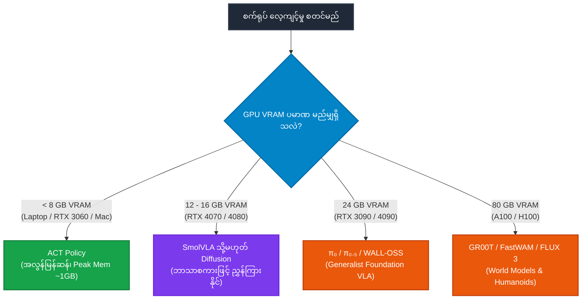
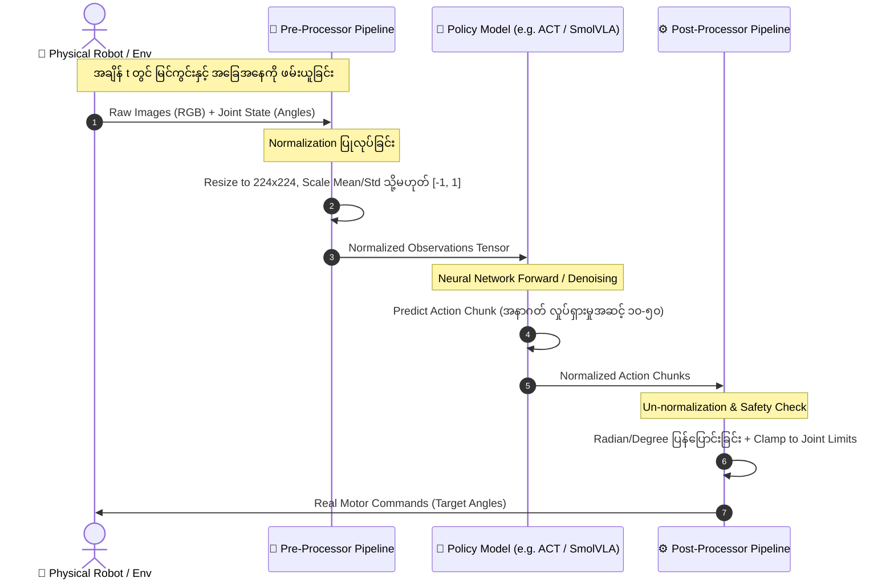

# LeRobot မော်ဒယ်များ စာရင်းနှင့် လမ်းညွှန် (Model Categories & Architecture)

ဤစာတမ်းသည် Hugging Face **LeRobot** repository တွင် ပါဝင်သော Robotic Policies၊ World Models၊ Reward Models နှင့် Reinforcement Learning စနစ်များအားလုံးကို နယ်ပယ်အလိုက် စနစ်တကျ ခွဲခြားပြသထားသော လမ်းညွှန်ဖြစ်ပါသည်။

---

## ၁။ မော်ဒယ်များ အမျိုးအစားအလိုက် ခြုံငုံဇယား (Category Overview)

အောက်ပါဇယားတွင် LeRobot ၏ မော်ဒယ်များအားလုံးကို အဓိက ကဏ္ဍ ၅ ခု ခွဲခြား၍ လင့်ခ်များဖြင့် တိုက်ရိုက် ကြည့်ရှုနိုင်ရန် စီစဉ်ထားပါသည်-

| Category (အမျိုးအစား) | Models (မော်ဒယ်များ) | အဓိက ရည်ရွယ်ချက်နှင့် အသုံးချမှု |
|:---|:---|:---|
| **Imitation Learning** (အပြာရောင် 🔵) | [ACT](#၁-act) • [Diffusion Policy](#၂-diffusion-policy) • [VQ-BeT](#၃-vq-bet) • [Multitask DiT Policy](#၄-multitask-dit-policy) | လူသားမောင်းနှင်ပြသမှု (Teleoperation) ဒေတာများမှတစ်ဆင့် ချောမွေ့တိကျသော လှုပ်ရှားမှုများကို တုပသင်ယူခြင်း |
| **Reinforcement Learning** (အစိမ်းရောင် 🟢) | [HIL-SERL (SAC)](#၅-hil-serl-soft-actor-critic) • [Gaussian Actor](#၆-gaussian-actor) • [TD-MPC](#၇-td-mpc) | အစမ်းသပ်လေ့ကျင့်မှု (Trial & Error) နှင့် လူသားကူညီသော Online RL ဖြင့် အကောင်းဆုံး စွမ်းဆောင်ရည် ရယူခြင်း |
| **VLAs Models** (ခရမ်းရောင် 🟣) <br>*(Vision-Language-Action)* | [π₀ (Pi0)](#၈-π₀-pi0) • [π₀-FAST](#၉-π₀-fast) • [π₀.₅ (Pi0.5)](#၁၀-π₀₅-pi05) • [SmolVLA](#၁၁-smolvla) • [GR00T N1.7](#၁၂-gr00t-n17) • [WALL-OSS](#၁၃-wall-oss--wall-x) • [FineART-VLA](#၁၄-fineart-vla) • [DM05](#၁၅-dm05-dm05) • [MolmoAct2](#၁၆-molmoact2) • [EO-1](#၁၇-eo-1) • [Evo-1](#၁၈-evo-1-evo1) • [X-VLA](#၁၉-x-vla) • [RTC (Real-Time Chunking)](#၂၀-rtc-real-time-chunking) | ဘာသာစကား ညွှန်ကြားချက် (Prompt) နှင့် မြင်ကွင်းတို့ကို ပေါင်းစပ်နားလည်ပြီး အထွေထွေ စက်ရုပ်လုပ်ငန်းများ စေခိုင်းခြင်း |
| **World Models** (လိမ္မော်ရောင် 🟠) | [FastWAM](#၂၁-fastwam) • [LaWAM](#၂၂-lawam) • [LingBot-VA](#၂၃-lingbot-va) • [FLUX 3 Action](#၂၄-flux-3-action) • [VLA-JEPA](#၂၅-vla-jepa) | ပတ်ဝန်းကျင်၏ ရူပဗေဒ dynamics နှင့် အနာဂတ် ဗီဒီယိုပြကွက်များကို ကြိုတင်ခန့်မှန်းကာ လုပ်ဆောင်ချက်များကို ထုတ်လုပ်ခြင်း |
| **Reward Models** (အနီရောင် 🔴) | [SARM](#၂၆-sarm) • [ROBOMETER](#၂၇-robometer) • [TOPReward](#၂၈-topreward) • [Reward Classifier](#၂၉-reward-classifier) | စက်ရုပ်၏ လုပ်ငန်းပြီးမြောက်မှု အဆင့် (Progress)၊ အောင်မြင်မှု (Success) နှင့် RL အတွက် ဆုကြေး (Reward) တွက်ချက်ခြင်း |

---

## ၂။ မော်ဒယ်များ၏ အခင်းအကျင်း ရုပ်ပုံကားချပ် (Color Architecture Map)

```mermaid
flowchart TD
    classDef imitation fill:#2563eb,stroke:#1d4ed8,stroke-width:2px,color:#ffffff;
    classDef rl fill:#059669,stroke:#047857,stroke-width:2px,color:#ffffff;
    classDef vla fill:#7c3aed,stroke:#6d28d9,stroke-width:2px,color:#ffffff;
    classDef world fill:#d97706,stroke:#b45309,stroke-width:2px,color:#ffffff;
    classDef reward fill:#dc2626,stroke:#b91c1c,stroke-width:2px,color:#ffffff;
    classDef center fill:#1f2937,stroke:#374151,stroke-width:3px,color:#ffffff;

    ROOT["LeRobot Robotics Ecosystem"]:::center

    ROOT --> C1["Imitation Learning"]:::imitation
    ROOT --> C2["Reinforcement Learning"]:::rl
    ROOT --> C3["VLAs Models (Foundation)"]:::vla
    ROOT --> C4["World Models"]:::world
    ROOT --> C5["Reward Models"]:::reward

    C1 --> ACT["ACT"]:::imitation
    C1 --> DIFF["Diffusion Policy"]:::imitation
    C1 --> VQ["VQ-BeT"]:::imitation
    C1 --> MDIT["Multitask DiT"]:::imitation

    C2 --> SAC["HIL-SERL (SAC)"]:::rl
    C2 --> GA["Gaussian Actor"]:::rl
    C2 --> TDMPC["TD-MPC"]:::rl

    C3 --> PI0["π₀ / π₀-FAST / π₀.₅"]:::vla
    C3 --> SMOL["SmolVLA"]:::vla
    C3 --> GROOT["GR00T N1.7"]:::vla
    C3 --> WALL["WALL-OSS / Wall-X"]:::vla
    C3 --> OTHER_VLA["DM05 / MolmoAct2 / EO-1 / EVO1 / X-VLA"]:::vla
    C3 --> RTC["RTC (Real-Time Engine)"]:::vla

    C4 --> FWAM["FastWAM"]:::world
    C4 --> LAWAM["LaWAM"]:::world
    C4 --> LING["LingBot-VA"]:::world
    C4 --> FLUX["FLUX 3 Action"]:::world
    C4 --> JEPA["VLA-JEPA"]:::world

    C5 --> SARM["SARM (Progress Reward)"]:::reward
    C5 --> ROBO["ROBOMETER (Video Eval)"]:::reward
    C5 --> TOPR["TOPReward (Zero-Shot)"]:::reward
    C5 --> CLF["Reward Classifier"]:::reward
```



---

## ၃။ အသေးစိတ် မော်ဒယ်များ ရှင်းလင်းချက် (Detailed Model Specifications)

---

### ကဏ္ဍ (၁) - Imitation Learning (အပြာရောင် 🔵 - အပြုအမူ တုပသင်ယူခြင်း မော်ဒယ်များ)

#### ၁။ ACT
- **Identifier**: `act` (`ACTPolicy`, `ACTConfig`)
- **Backbone**: CVAE + Transformer Encoder-Decoder + ResNet
- **အသုံးပြုပုံ**: စတင်လေ့လာသူများ၊ Laptop GPU အသုံးပြုသူများနှင့် Single-task အလုပ်များအတွက် အကောင်းဆုံး မော်ဒယ်ဖြစ်ပါသည်။
- **ဘာတွေတွက်ပေးသလဲ**:
  - 📥 **Input**: ကင်မရာပုံရိပ်များ (Multi-view RGB) + အဆစ်အနေအထား (Joint Positions)
  - 🔄 **တွက်ချက်ပုံ**: CVAE ဖြင့် လူသားလှုပ်ရှားမှုပုံစံများကို Latent Space $z$ ထဲသို့ သွင်းယူပြီး Transformer ဖြင့် အနာဂတ် Action အစီအစဉ်အပြုံလိုက် (Action Chunks) ကို တစ်ပြိုင်နက် တွက်ထုတ်သည်။
  - 📤 **Output**: Action Chunks (`[batch, chunk_size, action_dim]`)
- **အားသာချက်**: Memory သုံးစွဲမှု အလွန်နည်းခြင်း (~1 GB GPU VRAM) နှင့် ALOHA လက်နှစ်ဖက်သုံး စက်ရုပ်များတွင် အောင်မြင်မှု အလွန်မြင့်မားခြင်း။

#### ၂။ Diffusion Policy
- **Identifier**: `diffusion` (`DiffusionPolicy`, `DiffusionConfig`)
- **Backbone**: 1D Temporal CNN / Transformer + DDPM Schedulers
- **အသုံးပြုပုံ**: ပွတ်တိုက်ကိုင်တွယ်မှုများပြားသော (Contact-rich) အလုပ်များနှင့် လူသားသရုပ်ပြ လမ်းကြောင်းမျိုးစုံရှိသော အလုပ်များအတွက် သုံးပါသည်။
- **ဘာတွေတွက်ပေးသလဲ**:
  - 📥 **Input**: ကင်မရာမြင်ကွင်းနှင့် စက်ရုပ်အနေအထား (Observation History)
  - 🔄 **တွက်ချက်ပုံ**: ကျပန်း Gaussian Noise မှ စတင်ကာ Observation အပေါ်မူတည်၍ အဆင့်ဆင့် Denoise လုပ်ပြီး Action လမ်းကြောင်းကို တွက်ထုတ်သည်။
  - 📤 **Output**: စဉ်ဆက်မပြတ် ချောမွေ့သော Action Trajectory

#### ၃။ VQ-BeT
- **Identifier**: `vqbet` (`VQBeTPolicy`, `VQBeTConfig`)
- **Backbone**: VQ-VAE + minGPT Transformer + Offset Head
- **အသုံးပြုပုံ**: ဆုံးဖြတ်ချက် လမ်းကြောင်းမျိုးစုံ ကွဲပြားနိုင်သော (Multimodal) သရုပ်ပြဒေတာများ သင်ယူရန် သုံးပါသည်။
- **ဘာတွေတွက်ပေးသလဲ**:
  - 🔄 **တွက်ချက်ပုံ**: Continuous Actions များကို VQ-VAE ဖြင့် Discrete Latent Codes အဖြစ် ခွဲခြားပြီး Transformer က Code ရွေးချယ်ကာ Residual Offset ဖြင့် အတိအကျ ပေါင်းစပ်တွက်ထုတ်သည်။
  - 📤 **Output**: Discrete Cluster + Continuous Residual Offset Action

#### ၄။ Multitask DiT Policy
- **Identifier**: `multi_task_dit` (`MultiTaskDiTPolicy`, `MultiTaskDiTConfig`)
- **Backbone**: CLIP ViT-B/16 + Diffusion Transformer (~450M Params)
- **အသုံးပြုပုံ**: လုပ်ငန်းပေါင်းများစွာကို မော်ဒယ်တစ်ခုတည်းဖြင့် Generative Denoising ပြုလုပ်၍ လေ့ကျင့်လိုသည့်အခါ သုံးပါသည်။
- **ဘာတွေတွက်ပေးသလဲ**:
  - 🔄 **တွက်ချက်ပုံ**: စာသားနှင့် ပုံရိပ် Features များကို Conditioning ထည့်သွင်း၍ DiT Transformer ဖြင့် Denoising လုပ်ကာ Action များကို တွက်ထုတ်သည်။

---

### ကဏ္ဍ (၂) - Reinforcement Learning (အစိမ်းရောင် 🟢 - RL မော်ဒယ်များ)

#### ၅။ HIL-SERL (Soft Actor-Critic)
- **Identifier**: `sac` (`SACAlgorithm`, `SACAlgorithmConfig`)
- **အသုံးပြုပုံ**: တကယ့်စက်ရုပ်များပေါ်တွင် လူသားက ကြားဖြတ်ကူညီပေးသော Online Reinforcement Learning (HIL-SERL) စနစ်ဖြင့် လေ့ကျင့်ရန် သုံးပါသည်။
- **ဘာတွေတွက်ပေးသလဲ**:
  - 🔄 **တွက်ချက်ပုံ**: Maximum Entropy နိယာမအရ Expected Return သာမက Entropy (စူးစမ်းရှာဖွေနိုင်စွမ်း) ကိုပါ အမြင့်ဆုံးရရှိစေရန် Bellman Equation ဖြင့် Actor နှင့် Double-Critic Networks များကို Optimize လုပ်ပေးသည်။

#### ၆။ Gaussian Actor
- **Identifier**: `gaussian_actor` (`GaussianActorPolicy`, `GaussianActorConfig`)
- **Backbone**: CNN / ResNet + MLP Gaussian Head (Tanh-squashed)
- **အသုံးပြုပုံ**: SAC algorithm များတွင် Continuous Action များကို စူးစမ်းရှာဖွေ Sample ထုတ်ယူနိုင်ရန် အသုံးပြုပါသည်။
- **ဘာတွေတွက်ပေးသလဲ**:
  - 📤 **Output**: Action Probability Distribution ၏ ပျမ်းမျှတန်ဖိုး ($\mu$) နှင့် စံသွေဖည်ကိန်း ($\sigma$)

#### ၇။ TD-MPC
- **Identifier**: `tdmpc` (`TDMPCPolicy`, `TDMPCConfig`)
- **Backbone**: Latent World Model + MPPI / CEM Trajectory Optimizer
- **အသုံးပြုပုံ**: Latent Space ထဲတွင် အနာဂတ် simulation စမ်းသပ်မှု ထောင်ပေါင်းများစွာ ပြုလုပ်ပြီး အကောင်းဆုံး Action ရှာဖွေရန် သုံးပါသည်။
- **ဘာတွေတွက်ပေးသလဲ**:
  - 🔄 **တွက်ချက်ပုံ**: Temporal Difference ဖြင့် Latent Dynamics ကို သင်ယူပြီး MPPI ဖြင့် ဆုကြေးအများဆုံးရမည့် ပထမဆုံး Action ကို ရွေးချယ်တွက်ထုတ်သည်။

---

### ကဏ္ဍ (၃) - VLAs Models (ခရမ်းရောင် 🟣 - Vision-Language-Action မော်ဒယ်ကြီးများ)

#### ၈။ π₀ (Pi0)
- **Identifier**: `pi0` (`PI0Policy`, `PI0Config`)
- **Backbone**: PaliGemma VLM + Flow-Matching Action Expert
- **ဘာတွေတွက်ပေးသလဲ**:
  - 📥 **Input**: ကင်မရာမြင်ကွင်းများ + အင်္ဂလိပ်စာသား ညွှန်ကြားချက် + State
  - 🔄 **တွက်ချက်ပုံ**: PaliGemma ဖြင့် ပုံရိပ်နှင့် ဘာသာစကားကို နားလည်စေပြီး သီးသန့် Action Expert က 50 Hz အထိ မြန်ဆန်သော Flow Matching နည်းဖြင့် Actions တွက်ချက်သည်။
  - 📤 **Output**: High-Frequency Continuous Action Chunks

#### ၉။ π₀-FAST
- **Identifier**: `pi0_fast` (`PI0FastPolicy`, `PI0FastConfig`)
- **Backbone**: Gemma VLM + FAST (Frequency-space Action Sequence Tokenizer)
- **ဘာတွေတွက်ပေးသလဲ**:
  - 🔄 **တွက်ချက်ပုံ**: Continuous Actions များကို FAST နည်းဖြင့် Frequency Space တွင် Discrete Tokens အဖြစ် ပြောင်းပြီး LLM များအတိုင်း **Next-token prediction** ဖြင့် တွက်ထုတ်သည်။ (Diffusion ထက် ၅ ဆ ပိုမြန်စွာ Train နိုင်သည်)။

#### ၁၀။ π₀.₅ (Pi0.5)
- **Identifier**: `pi05` (`PI05Policy`, `PI05Config`)
- **Backbone**: အဆင့်မြှင့်တင်ထားသော Vision-Language Backbone + Flow Matching + RTC Engine
- **ဘာတွေတွက်ပေးသလဲ**:
  - မမြင်ဖူးသော ပတ်ဝန်းကျင်အသစ်များ၊ အခန်းအသစ်များတွင် ရူပဗေဒနှင့် အဓိပ္ပာယ်သဘောတရားအရ ကိုက်ညီသော **Open-World Generalized Action Chunks** များကို တွက်ထုတ်ပေးသည်။

#### ၁၁။ SmolVLA
- **Identifier**: `smolvla` (`SmolVLAPolicy`, `SmolVLAConfig`)
- **Backbone**: SmolLM / Vision + Flow-Matching Action Expert
- **ဘာတွေတွက်ပေးသလဲ**:
  - ပေါ့ပါးသော Architecture ဖြစ်ပြီး သာမန် GPU (16-24 GB) များပေါ်တွင် ဘာသာစကားဖြင့် ထိန်းချုပ်နိုင်သော **Lightweight VLA Actions** များကို အလွယ်တကူ Fine-tune တွက်ထုတ်ပေးသည်။

#### ၁၂။ GR00T N1.7
- **Identifier**: `groot` (`GrootPolicy`, `GrootConfig`)
- **Backbone**: NVIDIA Cosmos-Reason2 / Qwen3-VL + Flow Action Transformer
- **ဘာတွေတွက်ပေးသလဲ**:
  - NVIDIA ၏ လူတူစက်ရုပ် (Humanoid) နှင့် စက်ရုပ်လက်မောင်းမျိုးစုံအတွက် အထွေထွေ အသုံးပြုနိုင်သော **Cross-embodiment Action Chunks** များကို တွက်ထုတ်ပေးသည်။

#### ၁၃။ WALL-OSS / Wall-X
- **Identifier**: `wall_x` (`WallXPolicy`, `WallXConfig`)
- **Backbone**: Qwen2.5-VL + Flow Matching + LoRA Adaptation
- **ဘာတွေတွက်ပေးသလဲ**:
  - XSquare Robot မှ ထုတ်လုပ်ထားပြီး စက်ရုပ်လက်မောင်း၊ Mobile Manipulator ပုံသဏ္ဌာန်မျိုးစုံအတွက် Actions များကို LoRA ဖြင့် လွယ်ကူစွာ Post-train ပြုလုပ်တွက်ထုတ်ပေးသည်။

#### ၁၄။ FineART-VLA
- **Identifier**: `fineart_vla` (`FineARTVLAPolicy`, `FineARTVLAConfig`)
- **Backbone**: π₀.₅ + Dual-System (System 2 Language + System 1 Action Expert)
- **ဘာတွေတွက်ပေးသလဲ**:
  - **System 2** ဖြင့် ရှေ့ဆက်လုပ်မည့် Subtask ကို ဘာသာစကားဖြင့် ဆုံးဖြတ်ပြီး **System 1** Action Expert က အချိန်နှင့်တပြေးညီ Action Chunks များကို တွက်ထုတ်သည်။

#### ၁၅။ DM05 (DM0.5)
- **Identifier**: `dm05` (`DM05Policy`, `DM05Config`)
- **Backbone**: Dexmal OpenDM + Flow Matching
- **ဘာတွေတွက်ပေးသလဲ**:
  - ကင်မရာမြင်ကွင်းများနှင့် စာသားညွှန်ကြားချက်မှ Action Chunks များကို တွက်ထုတ်သည်။ (LIBERO Benchmark တွင် 197/200 ရရှိထားသည်)။

#### ၁၆။ MolmoAct2
- **Identifier**: `molmoact2` (`MolmoAct2Policy`, `MolmoAct2Config`)
- **Backbone**: Allen AI Molmo VLM + Layerwise Flow Expert
- **ဘာတွေတွက်ပေးသလဲ**:
  - Molmo ၏ Layer တိုင်းတွင် Flow Matching Action Expert များ ချိတ်ဆက်ထားပြီး ပုံရိပ်နှင့် စကားလုံးမှ တိုက်ရိုက် Action Trajectories များကို တွက်ထုတ်သည်။

#### ၁၇။ EO-1
- **Identifier**: `eo1` (`EO1Policy`, `EO1Config`)
- **Backbone**: Qwen2.5-VL + Flow Matching
- **ဘာတွေတွက်ပေးသလဲ**:
  - စက်ရုပ်ထိန်းချုပ်မှုကို စကားဝိုင်း (Conversation) ပုံစံဖြင့် Multimodal Tokens များကို Qwen2.5-VL ထံ ပေးသွင်းပြီး Action Tokens များကို Flow Matching ဖြင့် တွက်ထုတ်သည်။

#### ၁၈။ Evo-1 (EVO1)
- **Identifier**: `evo1` (`Evo1Policy`, `Evo1Config`)
- **Backbone**: InternVL3 + Flow Matching
- **ဘာတွေတွက်ပေးသလဲ**:
  - InternVL3 ၏ အဆင့်မြင့် Multimodal Tokens များကို အခြေခံကာ Flow-matching နည်းဖြင့် အနာဂတ် Action Chunks များကို အဆင့်ဆင့် တွက်ချက်ပေးသည်။

#### ၁၉။ X-VLA
- **Identifier**: `xvla` (`XVLAPolicy`, `XVLAConfig`)
- **Backbone**: Florence-2 + Learnable Soft Prompts
- **ဘာတွေတွက်ပေးသလဲ**:
  - မတူညီသော စက်ရုပ်အမျိုးအစားများကို Soft Prompts အဖြစ် သတ်မှတ်ပြီး မော်ဒယ်တစ်ခုတည်းဖြင့် မည်သည့်စက်ရုပ်အတွက်မဆို Actions များကို ခွဲခြားတွက်ထုတ်သည်။

#### ၂၀။ RTC (Real-Time Chunking)
- **Identifier**: `rtc` (`RTCConfig`, `ActionQueue`, `ActionInterpolator`)
- **အခန်းကဏ္ဍ**: Inference Runtime Execution Engine
- **ဘာတွေတွက်ပေးသလဲ**:
  - VLA မော်ဒယ်ကြီးများ စဉ်းစားတွက်ချက်နေချိန်တွင် ကြန့်ကြာမှုမဖြစ်စေရန် လက်ရှိ Action နှင့် နောက် Action ကို ချောမွေ့စွာ ဆက်စပ်ပေးသော **Action Interpolation / Queue Stream** ကို အချိန်နှင့်တပြေးညီ တွက်ချက်ပေးသည်။

---

### ကဏ္ဍ (၄) - World Models (လိမ္မော်ရောင် 🟠 - ဗီဒီယိုနှင့် ကမ္ဘာ့ရူပဗေဒ မော်ဒယ်များ)

#### ၂၁။ FastWAM
- **Identifier**: `fastwam` (`FastWAMPolicy`, `FastWAMConfig`)
- **Backbone**: Wan2.2 Video Diffusion Stack + Direct Action Predictor
- **ဘာတွေတွက်ပေးသလဲ**:
  - Video World Dynamics ကို သင်ယူထားသော်လည်း Inference အချိန်တွင် ဗီဒီယိုထုတ်မနေဘဲ **Direct Action Chunks** များကို မြန်ဆန်စွာ တိုက်ရိုက်တွက်ပေးသည်။

#### ၂၂။ LaWAM
- **Identifier**: `lawam` (`LaWAMPolicy`, `LaWAMConfig`)
- **Backbone**: Qwen3-VL + DINOv3 Latent World Model (LAM) + Flow Head
- **ဘာတွေတွက်ပေးသလဲ**:
  - Latent Space ထဲတွင် ပတ်ဝန်းကျင်၏ ရူပဗေဒ အခြေအနေအပြောင်းအလဲ (Dynamics) များကို ဦးစွာ ကြိုတင်တွက်ချက်ပြီး အကိုက်ညီဆုံး Actions များကို ထုတ်လုပ်သည်။

#### ၂၃။ LingBot-VA
- **Identifier**: `lingbot_va` (`LingBotVAPolicy`, `LingBotVAConfig`)
- **Backbone**: Wan2.2 Dual-Stream Mixture-of-Transformers
- **ဘာတွေတွက်ပေးသလဲ**:
  - "ဒီလိုလှုပ်ရှားလိုက်ရင် မြင်ကွင်းက ဘာဖြစ်သွားမလဲ" ဟူသော **အနာဂတ် ဗီဒီယို Latents** နှင့် **စက်ရုပ် Actions** များကို တစ်ပြိုင်နက် Autoregressive တွက်ချက်သည်။

#### ၂၄။ FLUX 3 Action
- **Identifier**: `flux3` (`Flux3Policy`, `Flux3Config`)
- **Backbone**: Black Forest Labs FLUX.3 Video Trunk + Action Head
- **ဘာတွေတွက်ပေးသလဲ**:
  - Video Latents နှင့် Action Chunks များကို FLUX.3 Transformer ပေါ်တွင် ပူးတွဲ Denoise လုပ်ကာ SO-101 နှင့် Franka စက်ရုပ်များအတွက် Actions ထုတ်ပေးသည်။

#### ၂၅။ VLA-JEPA
- **Identifier**: `vla_jepa` (`VLAJEPAPolicy`, `VLAJEPAConfig`)
- **Backbone**: Qwen3-VL + Meta V-JEPA2 + DiT Action Head
- **ဘာတွေတွက်ပေးသလဲ**:
  - Non-generative V-JEPA2 ဖြင့် Spatio-temporal visual embeddings များကို ထုတ်ယူကာ Qwen3-VL ဘာသာစကားနှင့် ပေါင်းစပ်ပြီး DiT Action Head ဖြင့် Actions တွက်ချက်သည်။

---

### ကဏ္ဍ (၅) - Reward Models (အနီရောင် 🔴 - ဆုကြေးနှင့် အကဲဖြတ် မော်ဒယ်များ)

#### ၂၆။ SARM (Stage-Aware Reward Model)
- **Identifier**: `sarm` (`SARMRewardModel`, `SARMConfig`)
- **ဘာတွေတွက်ပေးသလဲ**:
  - ဗီဒီယိုပြကွက်များမှ **Subtask အဆင့် ($k$)** နှင့် ထိုအဆင့်အတွင်း ပြီးမြောက်မှု **Progress ($\tau$)** ကို တွက်ချက်ပြီး $[0, 1]$ Dense Reward ထုတ်ပေးသည်။ (RA-BC ဒေတာအလေးပေးမှုနှင့် RL အတွက် သုံးသည်)။

#### ၂၇။ ROBOMETER
- **Identifier**: `robometer` (`RobometerRewardModel`, `RobometerConfig`)
- **Backbone**: Fine-tuned Qwen3-VL-4B + Progress/Success/Preference Heads
- **ဘာတွေတွက်ပေးသလဲ**:
  - ဗီဒီယိုလမ်းကြောင်းမှ တစ်ဖရိန်ချင်းစီအလိုက် **Task Progress ($[0, 1]$)**၊ **Success Probability** နှင့် လမ်းကြောင်း ၂ ခုအနက် ပိုကောင်းသော လမ်းကြောင်းကို နှိုင်းယှဉ်တွက်ပေးသည်။

#### ၂၈။ TOPReward
- **Identifier**: `topreward` (`TOPRewardModel`, `TOPRewardConfig`)
- **Backbone**: Zero-shot Qwen3-VL-8B Engine
- **ဘာတွေတွက်ပေးသလဲ**:
  - မော်ဒယ် Train ရန်မလိုဘဲ VLM ထံမှ အလုပ်ပြီးမြောက်ကြောင်း အဖြေဖြစ်သည့် `True` တိုကင် ထွက်ပေါ်လာမည့် **Log-probability ($\log P(\text{True})$)** ကို Zero-shot Reward အဖြစ် တွက်ယူသည်။

#### ၂၉။ Reward Classifier
- **Identifier**: `reward_classifier` (`Classifier`, `RewardClassifierConfig`)
- **Backbone**: ResNet-10 / CNN Binary Classifier
- **ဘာတွေတွက်ပေးသလဲ**:
  - စက်ရုပ်ရောက်နေသော မြင်ကွင်းသည် အောင်မြင်သွားပြီလား (Success=1) မအောင်မြင်သေးဘူးလား (Fail=0) ဟူသော **Class Logits** ကို တွက်ပေးသည်။

---

## ၄။ Hardware အလိုက် ရွေးချယ်မှု လမ်းညွှန်ကားချပ် (Color Decision Tree)



---

## ၅။ အမြန်လေ့ကျင့်နိုင်သော CLI Commands

```bash
# ၁။ ACT ဖြင့် Training စတင်ခြင်း (စတင်လေ့လာသူများအတွက် အကြံပြုဆုံး)
lerobot-train \
  --dataset.repo_id=lerobot/aloha_mobile_cabinet \
  --policy.type=act \
  --policy.device=cuda \
  --output_dir=outputs/train/act_run \
  --batch_size=8 \
  --steps=50000

# ၂။ SmolVLA (VLA Model) ဖြင့် Training စတင်ခြင်း
lerobot-train \
  --dataset.repo_id=lerobot/libero \
  --policy.type=smolvla \
  --policy.device=cuda \
  --output_dir=outputs/train/smolvla_run \
  --batch_size=4 \
  --steps=50000
```

---

## ၆။ စက်ရုပ်နှင့် မော်ဒယ်အကြား ဒေတာစီးဆင်းမှု ပိုက်လိုင်း (Dataflow Sequence Pipeline)



